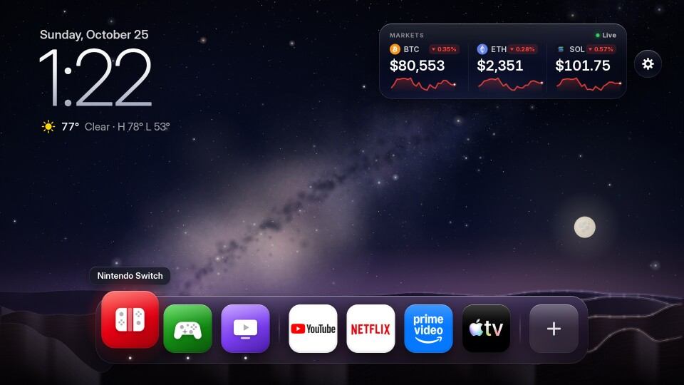
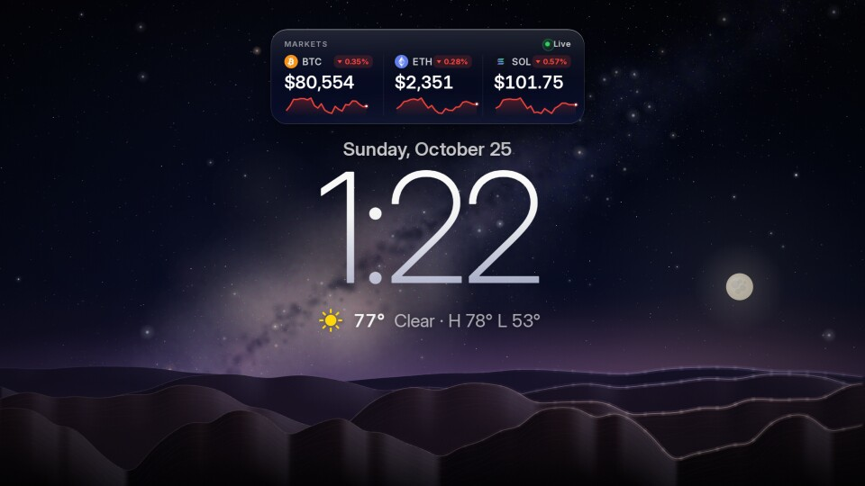

# Dock, for rooted LG webOS TVs

An ad-free, Apple TV-style home screen for LG webOS 6 TVs, and the root, privacy and debloat playbook that puts it there. Press Home and land on your own screen: a big clock, a wallpaper the TV draws itself, the weather, a crypto ticker, and a glass dock with your apps and HDMI inputs. LG's home app never runs. Its ad, ACR (screen fingerprinting), voice and telemetry services are kept down at every boot.





Built on two 2021 LGs (75NANO85APA and 55UP7670PUC, webOS 6.5.3, firmware 03.53.45), rooted with SlopBro and Homebrew Channel 0.7.3. It should work on other webOS 6 sets rooted through Homebrew Channel; nothing else is tested. The research behind every decision, with sources, is in [`docs/RESEARCH.md`](docs/RESEARCH.md); what each step changes on the TV and how to undo it is in [`docs/PLAYBOOK.md`](docs/PLAYBOOK.md).

## What you get

- **Dock is Home.** The app is bind-mounted over LG's own Home, so the Home key, boot and leaving an app all land on it. LG's native home process is gone: about 180 MB back on the 75" (938 MB used with Dock against 1116 with LG's Home), 625 MB against 803 at boot on the 1 GB 55".
- **No ads, no tracking, at boot:** 229 LG ad, ACR and telemetry hostnames resolve to localhost on the TV; the log shipper, content miner, promo nudges, ACR, sports alerts, voice and Alexa daemons stay down; the ad daemons are stubbed, so LG's sponsored banner slot is empty; the optional user agreements (viewing information, ACR ads, voice, interest-based ads, marketing) are declined again at every boot, because LG turns them back on.
- **No background apps:** LG preloads YouTube and Netflix and keeps apps resident; the hook turns that off and closes anything left in the background. 230 MB back, at the cost of about a second on a cold launch.
- **Markets:** BTC, ETH and SOL with 24-hour sparklines, from CoinGecko's free API (no key, no account). Prices flash as they tick.
- **Weather:** from Open-Meteo for the ZIP the TV was set up with, no key.
- **Lock screen:** after a few idle minutes the dock fades out and the clock, weather and markets take the screen, drifting against burn-in. LG's own screensaver stays out of the way.
- **Nothing to run anywhere else.** Everything lives on the TV and re-applies itself at boot. Your computer is only needed to set it up.
- **Fast:** plain HTML, CSS and JS for the TV's Chromium 79, no framework, no build step; about 60 fps on focus moves on the 2021 chip.

## Before you start

- Rooting is on you. SlopBro is a software-only root with a low brick risk, the TV's warranty is your own call, and a **factory reset removes root, Homebrew Channel and everything here**. That is also the way back if anything goes wrong.
- Everything the hooks do is in RAM: a reboot without them is a stock TV. Dock-as-Home is a bind mount, also RAM only.
- **Turn automatic firmware updates off first** (Settings > Support > Software Update): a newer build may close the exploit. Homebrew Channel also blocks LG's update servers once it is in.
- **LG's Dev Mode app must not be installed**, before or after: it wipes root.
- Never write to the TV's system partitions. Nothing here does.
- You need a computer on the same network as the TV with Python 3.9+. No Node, no LG SDK, no app store accounts.

## Quick start

```bash
cp tools/tvs.conf.example tools/tvs.conf   # your TV's address; git ignores this file
python3 tools/lgtv.py pair                  # the TV asks to allow this computer: press Yes, quickly
python3 tools/lgtv.py snapshot backups/tv   # a baseline: apps, inputs, home bar, system info
```

Root it (a trip to the TV: it shows a dialog at the end):

```bash
tools/root            # runs SlopBro against the TV; press "Reboot now" when it asks
tools/bootstrap-root  # after the reboot: your SSH key for root, sshd at boot, update servers blocked, telnet closed
```

Then, all from the computer:

```bash
tools/push-hook       # the privacy hook: applied now and at every boot
tools/install-home    # Dock becomes the TV's Home (the screen goes black for a few seconds)
```

Back out any time: `tools/restore-lg-home` puts LG's Home back now and after reboots; `touch /var/lib/webosbrew/tvproject/DISABLE` on the TV pauses the privacy hook; a factory reset removes all of it. The optional steps (removing LG's promo stub apps, the remote cold-boot trick when SlopBro's reboot dialog is gone, a second TV) are in the [playbook](docs/PLAYBOOK.md).

## Using Dock

- Arrows and OK move and open. Up reaches the gear.
- Blue on a tile edits the dock: the arrows move it, Red removes it. The Add tile lists everything else installed.
- Yellow shows the lock screen; the first press on it only wakes it.
- Back closes sheets. The Magic Remote's pointer works too.
- Settings: wallpaper (Desert Night, Aurora, Liquid Glass; all drawn on the TV), the lock screen delay, the Markets card, closing apps when leaving them, LG's own settings, About.

The first run on a TV puts its connected HDMI inputs on the dock ahead of YouTube, Netflix, Prime Video and Apple TV; input tiles take their look from what the TV says is plugged in. The configuration lives in `/var/lib/webosbrew/tvproject/dock.json` on the TV.

## Developing

Design work happens in a desktop browser: serve the repository root (`python3 -m http.server 8765`) and open `http://localhost:8765/app/index.html`. `app/js/preview.js` stands in for the TV's services when the page isn't on webOS, with made-up prices; add `?markets=live` for the real CoinGecko feed. Real app icons come from `preview/icons/`, which git ignores: copy them from a TV over SSH (`/usr/palm/applications/<id>/icon.png` and `/media/cryptofs/apps/usr/palm/applications/<id>/`).

The TV runs Chromium 79: no `?.`, `??`, flex `gap`, `inset` or masks, and animate only transform and opacity. `Perf` in the app logs focus-move frame times and wallpaper draw times to `/tmp/dock.log` on the TV. `tools/install-app` installs a separate dev copy from LG's app list without touching Home; `tools/tv-shot` grabs what the TV is showing.

## Tools

All of them talk to the TV named by `LGTV_HOST`, else the first line of `tools/tvs.conf`; `tools/tv <name> ...` picks one by name when there are several.

| | |
|---|---|
| [`tools/lgtv.py`](tools/lgtv.py) | The TV over LG's official API (standard-library Python): pair, info, apps, inputs, home bar, screenshots, remote keys, and internal settings calls without root |
| [`tools/root`](tools/root) | Runs the vendored SlopBro against the TV with the saved pairing key |
| [`tools/bootstrap-root`](tools/bootstrap-root) | Right after the root: the SSH key, sshd and the update block over Homebrew Channel's telnet, then telnet closed |
| [`tools/tvsh`](tools/tvsh) | Root shell on the TV over SSH with the project's key (`tools/tvsh 'free -m'`) |
| [`tools/push-hook`](tools/push-hook) | Push `tv/` to the TV's Homebrew Channel boot hooks and run the privacy hook once |
| [`tools/install-home`](tools/install-home) | Make Dock the TV's Home, or push a new version there (`--stage` for a quiet update at the next Home reload); [`tools/restore-lg-home`](tools/restore-lg-home) puts LG's back |
| [`tools/install-app`](tools/install-app) | The dev copy: build the IPK (`tools/build-ipk.py`), push it, install it as root, open it |
| [`tools/tv-shot`](tools/tv-shot) | A screenshot of what the TV shows right now |
| [`tools/tv`](tools/tv) | Run any of the above against one TV by name (`tools/tv bedroom install-home`) |
| `tv/` | What runs on the TV at boot: the privacy hook, the hosts blocklist, the service lists, the no-background-apps watcher, the settings check, the Home hook |
| `vendor/slopbro-21023d5/` | The root, pinned and audited (`SOURCE.md`) |

On the TV, `luna-send` reads stdin: in scripts always give it `</dev/null`, or it eats the script and exits silently.

## License

MIT (`LICENSE`). The vendored root is AGPL-3.0 and the hosts list is GPL-3.0; see [`docs/THIRD-PARTY.md`](docs/THIRD-PARTY.md), which also credits the projects this builds on: SlopBro and Homebrew Channel (webosbrew), Free My TV, cleanyourtv-WebOS, AltHome, hagezi's blocklists, Open-Meteo, CoinGecko, Inter.

Built with Claude Code.
