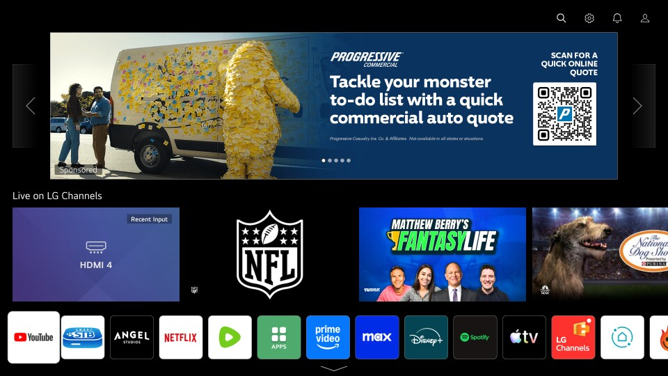
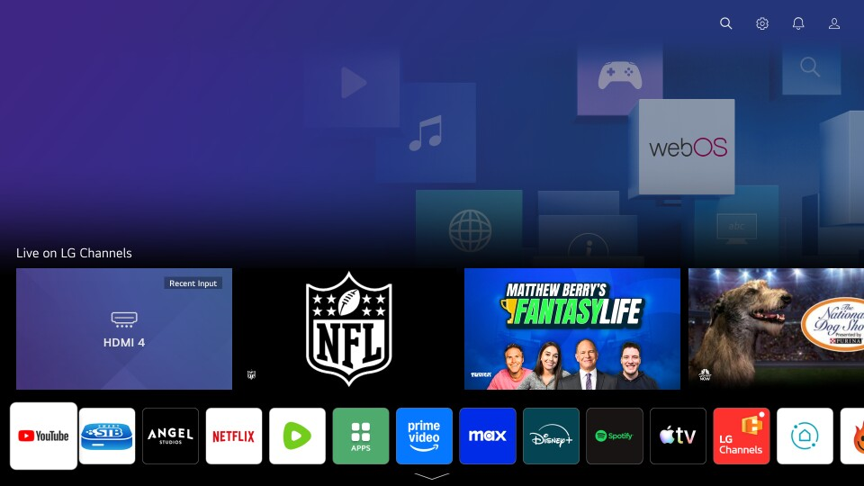

# Playbook: what changes on the TV, and how to undo it

Everything here was done on two 2021 LGs (webOS 6.5.3, firmware 03.53.45) and verified across reboots. Every change is reversible; most are in RAM and gone after a reboot without the hook. The only thing that isn't is root itself, which a factory reset removes (Settings > General > System > Reset to Initial Settings).

## 1. Pairing and the baseline (no root needed)

`python3 tools/lgtv.py pair` registers your computer with the TV's official remote API; the TV asks to allow it. **It cancels an unanswered prompt within seconds**, so answer while someone is in front of it, or loop the command. The key lands in `.secrets/lgtv.json` (git ignores `.secrets/`). Undo: delete the key; a factory reset revokes it on the TV.

`python3 tools/lgtv.py snapshot backups/<dir>` saves the app list (with ids, versions, which ones are LG's "stub" placeholders), the HDMI inputs, the home bar order and the system info as JSON. Keep it; it is the before-state of everything below.

Without root the API can't write settings, but an alert whose close action points at an internal `luna://` call runs it anyway (`tools/lgtv.py luna URI JSON`, the trick bscpylgtv uses; fire-and-forget). Live Plus, LG's ACR, can be turned off this way before rooting:

```bash
python3 tools/lgtv.py luna com.webos.settingsservice/setSystemSettings '{"category":"option","settings":{"livePlus":"off"}}'
```

Undo: the same call with `"on"`.

## 2. Root

`tools/root` runs the vendored SlopBro (AGPL-3.0, throwaway96; pinned commit and file hashes in `vendor/slopbro-21023d5/SOURCE.md`) with the pairing key, so the TV asks nothing twice. What it does: launches one of LG's own overlay apps pointed at a page served from your computer; that page runs `autoroot.sh` as root, which installs Homebrew Channel 0.7.3 from webosbrew's official GitHub release and makes root persist. It contacts nothing but your computer and GitHub, and toasts each step on screen. It ends with a dialog: **Reboot now**.

Rules: automatic firmware updates off first; LG's Dev Mode app never installed. Undo: factory reset.

**The reboot, when the dialog is gone** (an unrooted TV can't be rebooted from outside): switch Quick Start+ off through the alert trick, put the TV in standby through the official API, and wake it with a Wake-on-LAN packet to its MAC; with Quick Start+ off that standby is a shutdown and the wake a cold boot. Put Quick Start+ back afterwards (as root, or on the remote).

```bash
python3 tools/lgtv.py luna com.webos.settingsservice/setSystemSettings '{"category":"option","settings":{"quickStartMode":"off"}}'
python3 tools/lgtv.py call ssap://system/turnOff
# then a WoL packet to the TV's MAC; root telnet (port 23) is up about 40 s after the wake
```

`tools/bootstrap-root` then uses Homebrew Channel's root telnet, open with no password after a root, to install your SSH key for root (`.secrets/lgtv_ed25519`, made on first use), turn sshd on now and at boot, block LG's update servers at boot, and close telnet now and at boot. From then on `tools/tvsh` is a root shell. Undo: on the TV, delete `/var/luna/preferences/webosbrew_sshd_enabled`, `webosbrew_block_updates`, `webosbrew_telnet_disabled` and `/home/root/.ssh/authorized_keys`.

## 3. The privacy hook (`tv/20-tvproject-privacy`)

`tools/push-hook` copies `tv/` to `/var/lib/webosbrew/tvproject/` and the hook to `/var/lib/webosbrew/init.d/`, where Homebrew Channel runs it at every boot, and runs it once now. Pause it without removing: `touch /var/lib/webosbrew/tvproject/DISABLE`. Remove: delete the hook file and reboot.

| Step | What | Undo (live) |
|---|---|---|
| hosts | the hostnames in `tv/hosts-block-lg.txt` (hagezi's `native.lgwebos`: the ACR endpoint, LG ads, beacons, telemetry) resolve to localhost through a writable copy of `/etc/hosts` | `umount /etc/hosts` |
| stop | `remotelogger` (log shipping), `contentminer`, `nudge` (promos), `voiceinput`, `voiceconductor`, `lgchannelurl` (LG Channels) are stopped and masked for this boot (`systemctl mask --runtime`), because `remotelogger` and `nudge` were seen starting again later in the boot | `systemctl unmask --runtime <name>.service; systemctl start <name>.service` |
| stub | a do-nothing script is bind-mounted over `acr2` (ACR), `sportsalarm`, `amazon-alexa-adapter`, `amazon-alexa-vsk`, `admanager`, `adoverlay-service` (LG Home's sponsored banner) and `/usr/bin/com.webos.app.voice` (the voice overlay, 37 MB resident, which nothing else can close) | `umount /usr/sbin/<name>` |
| no background apps | `tv/no-background-apps.sh` closes any app left in the background for ~40 s (inputs, Home, AirPlay and Homebrew Channel excepted) and turns LG's background preloading off for the apps in `tv/no-preload-apps`, re-applied every 30 min because the policy only holds in memory. Measured on a 75" NANO85: preloading saved 1.1 s on a Netflix launch (2.4 s cold) and 0.5 s on YouTube, and the resident apps cost 230 MB | `pkill -f no-background-apps.sh` |
| settings | `tv/privacy-settings.js` (node, which the TV has) reads the promo settings, Live Plus, LG Channels, the ten optional agreements and the update mode, writes only what differs, and runs a second pass two minutes later. **The agreement flags come back on at every boot** (LG re-syncs them; SAM keeps its own copy in `/var/luna/preferences/eula`), which is why this runs at boot and not once. Log: `/tmp/tvproject-settings.log` | write the before-state back with the same calls |

The settings it enforces (`luna://com.webos.settingsservice/setSystemSettings`):

| Category | Keys | Value |
|---|---|---|
| `general` | `homePromotion`, `screenSaverAd`, `adCookie`, `voiceLongDistance` | `off` |
| `other` | `contentRecommendation` | `off` |
| `option` | `livePlus` (ACR), `livePromotion`, `webOSPromotionVideo`, `channelplus` (LG Channels) | `off`; `appUpdateMode` `manual` |
| `eulaStatus` | `acrOnAllowed`, `acrAdAllowed`, `voiceAllowed`, `voice2Allowed`, `customAdAllowed`, `marketingOnAllowed`, `additionalDataAllowed`, `shoppingOnAllowed`, `takeOnAllowed`, `chpAllowed` | `false` (the Terms of Use and the network agreement stay accepted; the Content Store keeps working) |
| update service | `luna://com.webos.service.update/setNSUMode` | `{"mode":"user"}` (automatic updates off) |

LG's Home before and after the ad daemons were stubbed (the sponsored slot goes blank, the rest keeps working):





Not touched: `rdxd` and `uploadd` (crash and diagnostic uploaders) keep running, but Homebrew Channel bind-mounts their spool directories read-only at every boot. The Advertisement menu's "Reset AD ID" has no API; press it once on the remote (General > System > Additional Settings > Advertisement).

## 4. LG's stub apps

Eleven of the home bar's entries on a stock 2021 LG are "stub" apps: promo placeholders that aren't even installed until clicked. As root:

```bash
luna-send -n 1 -w 30000 luna://com.webos.appInstallService/remove '{"id":"<id>"}' </dev/null
```

| id | name |
|---|---|
| `com.lgshop.app` | ShopTime |
| `com.lgtravel.app` | LG Travel+ |
| `com.lgtvod.us.app` | LG Movies & TV |
| `com.miniclip.eightballpool` | 8 Ball Pool |
| `com.plutotv.app` | Pluto TV |
| `com.tubitv.ott.tubi` | Tubi |
| `com.twin.app.audiochannel` | LG Radio+ |
| `com.twin.app.gamingportal` | LG Gaming Portal |
| `com.volley.lgshell` | Weekend Games |
| `epoxyaisports` | LG Sports Playbook |
| `webos.day` | LG Streaming Week |

Your snapshot's `apps.json` lists which are stubs on your TV (`"type": "stub"`). Undo: reinstall from the LG Content Store (LG may push its stubs back on its own). If **Hola VPN** (`com.brd.test`) is on the TV, remove it: free Hola makes the device a peer in Bright Data's residential proxy network. LG Channels can't be removed; the hook disables it (setting, agreement and service) and its icon stays.

## 5. Dock as Home (`tv/30-tvproject-home`)

`tools/install-home` stages the app in `/media/developer/dock-home/` with an `appinfo.json` derived from LG's own Home (saved to `backups/<tv>/home-appinfo.orig.json` the first time) and runs the Home hook, which:

1. gives the home id a bus identity: a role, the permission groups Dock needs (Homebrew Channel's `exec` among them) and a manifest in `/var/luna-service2-dev/` (`tv/home-acg-*.json`, `tv/home-client-permissions.json`), then `ls-control scan-services`. Without it the hub logs "No role file for application id com.webos.app.home" and drops every call: no icons, no ticker. The manifest's own id must not be `com.webos.app.home`, which collides with LG's and is skipped;
2. bind-mounts the staged copy over `/usr/palm/applications/com.webos.app.home`;
3. restarts SAM so it reads the new appinfo (the screen goes black for a few seconds; an AirPlay child of SAM is killed so the stop doesn't wait 90 s), and opens Home.

Updates: `tools/install-home` again (webOS keeps the old page alive in WebAppMgr, so it restarts that); `--stage` only puts the files in place for the next Home reload. Undo: `tools/restore-lg-home` unmounts, removes the three identity files, restarts SAM and WebAppMgr, opens LG's Home and sets `DISABLE-HOME` so reboots stay stock. Pause at boot: `touch /var/lib/webosbrew/tvproject/DISABLE-HOME`.

Dock's root-only needs (the full app list with icons, closing apps, its config file) go through Homebrew Channel's `exec` service; launching apps and inputs and reading the HDMI ports are plain Luna calls. It registers with LG's screensaver handshake (`tvpower/registerScreenSaverRequest`) and declines LG's screensaver while it is on screen. Config: `/var/lib/webosbrew/tvproject/dock.json`.

The dev copy (`tools/install-app`) is an ordinary app installed as root with no Dev Mode app, opened from LG's app list. Undo: `luna-send -n 1 luna://com.webos.appInstallService/dev/remove '{"id":"org.webosdock.app"}' </dev/null`.

## 6. A second TV

Add it to `tools/tvs.conf`, then `tools/tv <name> lgtv.py pair`, `snapshot`, `root`, `bootstrap-root`, `push-hook`, `install-home`. The pairing key is per TV; the SSH key is shared. Dock's first run seeds the dock from that TV's connected inputs. On a 1 GB UP7670 it all took one Allow press at the TV; the rest ran from the computer, including the reboot (section 2).

## 7. Gotchas

- `luna-send` reads its stdin. In a piped script it eats the script and exits silently with nothing done. Always give it `</dev/null`.
- Homebrew Channel's `exec` service can wedge after an app install (zombie shells under its node process, every call timing out, so Dock's root calls hang). `tools/install-app` checks and restarts it; by hand: `pkill -9 -f '^org.webosbrew.hbchannel.service'`, then its `elevate-service`.
- The agreement flags revert at boot (section 3). A one-time opt-out on the remote or by API does not hold.
- Daemons stopped early in the boot can be started again later in it. The hook masks them for the boot.
- A hosts file matches exact names only: `us.info.lgsmartad.com` is not caught by `lgsmartad.com`. The list covers the names seen; a DNS filter on the network (hagezi's `native.lgwebos` in AdGuard Home or Pi-hole) covers subdomains and the few seconds at boot before the hook runs. Never block `lgtvsdp.com`, `lgappstv.com` or `nextlgsdp.com`: the clock, certificates, the store and casting depend on them.
- Boot storm: for ten minutes after a boot the load average sits above 30 (MStar driver threads) while the CPU is mostly idle; the first wallpaper draw takes about a second then and a quarter of that later.
- Quick Start+ on means standby is a suspend, not a shutdown; root persisted through both on these sets.
